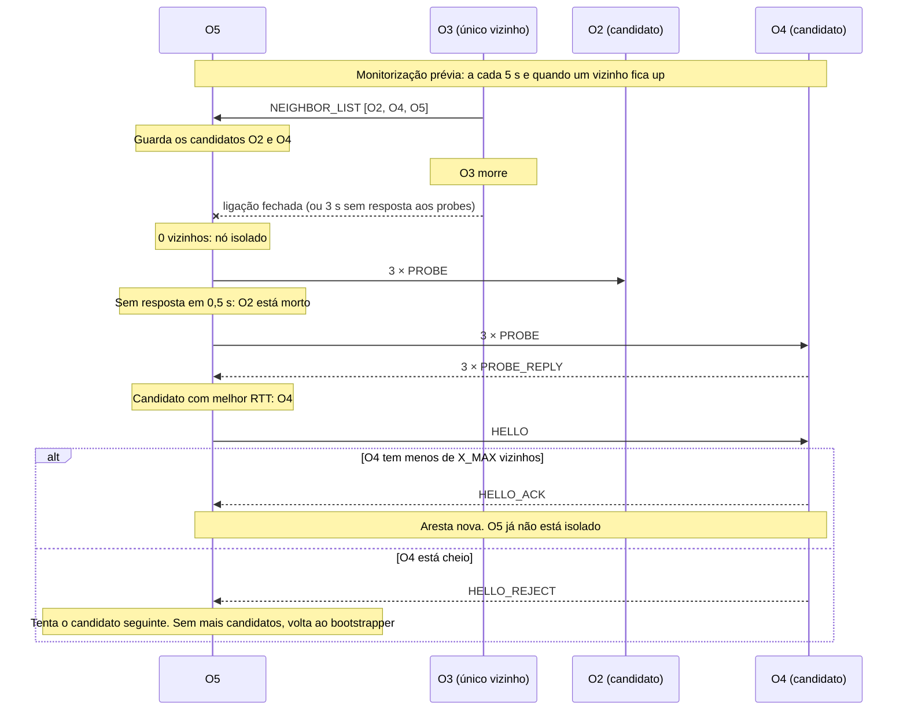

# Fase 2: métricas por link, função de custo e autorreparação

Este documento explica o que a Fase 2 faz e porquê, para servir de base ao relatório e à defesa.

**Onde está no código:** `ott/metrics.py` (probes, RTT, perda, packet pair), `ott/cost.py` (função de custo), `ott/repair.py` (gossip e reparação), `ott/config.py` (parâmetros).

**De onde vêm os valores medidos:** dois nós reais num *network namespace* Linux, com limites aplicados pelo `tc` à interface `lo`. Cada pacote passa duas vezes pelo `tc`, uma em cada sentido. Ainda não foram medidos no CORE; a lista de testes a fazer lá está no `README.md`.

## 1. O que é medido e como

Cada nó envia um probe UDP a cada vizinho a cada 200 ms (`PROBE_INTERVAL`), e o vizinho devolve-o. Com isto mantém, por link, um objeto `LinkMetrics`.

| Métrica | Como é calculada | Para que serve |
|---|---|---|
| **SRTT** (atraso) | Média móvel exponencial do RTT: `srtt = (1 − α)·srtt + α·rtt`, com α = 0,125 | Atraso típico do link |
| **RTTVAR** (jitter) | Média móvel do desvio: `rttvar = (1 − β)·rttvar + β·\|rtt − srtt\|`, com β = 0,25, atualizado **antes** do SRTT | Variação do atraso |
| **Perda** | Fração de probes sem resposta nos últimos 50, os que estão dentro de `DEAD_TIMEOUT` não contam | Qualidade do link |
| **Capacidade** | Packet pair, mediana das últimas 9 estimativas (secção 4) | Saber se o vídeo cabe no link |
| **Última resposta** | Instante da resposta mais recente | Detetar vizinhos mortos |

Na primeira amostra usa-se `srtt = rtt` e `rttvar = rtt/2`, como no TCP (RFC 6298).

Os mesmos probes servem de heartbeat: um vizinho sem resposta durante 3 s (`DEAD_TIMEOUT`) é declarado morto e a ligação é fechada. Assim as métricas e a deteção de falhas não duplicam tráfego.

Um nó responde a um `PROBE` de **qualquer** nó, mesmo que não seja vizinho: a reparação precisa disso para medir candidatos. Uma resposta é associada ao vizinho pelo campo `src`, nunca pelo IP de origem, porque no CORE um nó tem várias interfaces e pode responder por um IP diferente daquele para onde se enviou o probe.

## 2. Porque é que o RTT é medido no próprio nó

Para medir o atraso num só sentido seria preciso comparar o relógio do emissor com o do recetor, e esses relógios teriam de estar sincronizados com uma precisão bem melhor do que o atraso a medir. Com o RTT, os dois instantes são lidos no mesmo nó e só interessa a diferença entre eles. O outro nó limita-se a devolver a mensagem, sem nunca ler o relógio.

Usa-se `time.monotonic()` em vez de `time.time()` porque nunca anda para trás: um acerto de NTP não pode criar RTTs errados ou negativos.

O preço é que o atraso num só sentido é apenas aproximado por `RTT/2`, o que assume um link simétrico. Num link assimétrico, o valor é a média dos dois sentidos.

## 3. Função de custo

```
custo = SRTT/2 + K_JITTER × RTTVAR + K_LOSS_MS × perda + W_BW_MS × BW_REQUIRED / capacidade + HOP_COST
```

O custo vem em milissegundos. Cada métrica é convertida numa penalização em ms ("atraso equivalente") e soma-se. Assim, a perda e a falta de capacidade contam mesmo quando o atraso é quase nulo, como acontece no CORE sem atraso configurado.

| Termo | Porquê | Valor |
|---|---|---|
| `SRTT/2` | Atraso estimado num sentido, o que o vídeo sente | Medido |
| `K_JITTER × RTTVAR` | Atraso extra que o buffer do cliente tem de absorver | `K_JITTER = 1`: já é tempo, por isso pesa o mesmo que o atraso |
| `K_LOSS_MS × perda` | A perda estraga o vídeo independentemente do atraso | `K_LOSS_MS = 100`: 10% de perda = +10 ms |
| `W_BW_MS × BW_REQUIRED / capacidade` | Um link sem capacidade para o vídeo também o estraga. Vale 0 com a capacidade desconhecida | `W_BW_MS = 10`: capacidade igual ao necessário (2 Mbit/s) = +10 ms; metade dessa capacidade = +20 ms |
| `HOP_COST` | Desempata pelo número de saltos e mantém o custo sempre positivo, condição para o flooding terminar e não haver ciclos | 1 ms |

Um link com menos de 5 amostras (`MIN_SAMPLES`) custa `DEFAULT_LINK_COST` (50 ms), em qualquer modo, para não se preferirem links desconhecidos.

**Modos de comparação (`COST_MODE`):** `full` usa a fórmula completa, `latency` usa `SRTT/2 + HOP_COST` e `hops` usa só `HOP_COST`. Servem para medir nos testes o ganho de usar métricas completas. Em `hops`, durante o primeiro segundo de cada link o custo é o por omissão, por isso não é exatamente uma contagem de saltos nessa altura.

**Exemplo:** SRTT 100 ms, RTTVAR 20 ms, perda 20%, capacidade 4 Mbit/s dá `50 + 20 + 20 + 5 + 1 = 96 ms`.

### Alternativa rejeitada: fórmula multiplicativa

A primeira versão era `(SRTT/2 + K_JITTER × RTTVAR) × (1 + K_LOSS × perda) × (1 + W_BW × BW_REQUIRED / capacidade) + HOP_COST`, com `K_LOSS = 10` e `W_BW = 1`.

Foi rejeitada porque a perda e a capacidade multiplicavam só o atraso e o jitter, e por isso quase não pesavam quando estes eram quase nulos. A tabela compara as duas com valores medidos em `lo`:

| Link | Multiplicativa | Aditiva |
|---|---|---|
| Perda configurada de 10% (18% e 19% medidos, nas duas corridas), atraso quase nulo | 1,84 ms | 20,5 ms |
| Limpo, 5 ms de atraso num sentido (calculado) | cerca de 6 ms | cerca de 6 ms |

Com a fórmula multiplicativa, a rota preferia o link com perda. Com a aditiva, prefere o link limpo.

### Contrapartida da fórmula aditiva

Os pesos fixam uma equivalência entre perda e atraso: 10% de perda vale tanto como 10 ms. Um link com 20% de perda continua a ser preferido a um link limpo com mais 25 ms de atraso. `K_LOSS_MS` e `W_BW_MS` são escolhas do grupo, ainda por avaliar nos testes.

## 4. Packet pair

Cada nó envia a cada vizinho, a cada 5 s (`PAIR_INTERVAL`), dois datagramas seguidos de 1200 bytes (`PAIR_SIZE`). O link mais lento do caminho espaça-os: entre as chegadas passa o tempo de transmitir um pacote nesse link. O recetor calcula:

```
capacidade = PAIR_SIZE × 8 / (t1 − t0)    [bits/s]
```

Um par é descartado se faltar um dos pacotes, se chegarem trocados ou se o intervalo for 0. O valor final é a **mediana** das últimas 9 estimativas, porque o método é ruidoso e a mediana ignora valores extremos, ao contrário da média.

**Quem mede é o recetor**, e o valor fica no `LinkMetrics` do vizinho que enviou o par. O custo que um nó soma a um anúncio é o do link do vizinho para ele, que é o sentido em que os dados viajam, por isso é exatamente esse sentido que interessa medir.

### Limitações

Valores medidos com os parâmetros por omissão, salvo indicação:

| Situação | Medido | O que significa |
|---|---|---|
| `netem` 1 Mbit | 1,0 Mbit/s (sempre) | Funciona quando o limitador espaça mesmo os pacotes |
| `netem` 10 Mbit (par a cada 0,5 s) | 9,9 Mbit/s | Idem |
| `netem` 100 Mbit (par a cada 0,5 s) | 145 Mbit/s | A 100 µs por pacote, o tempo do Python já pesa |
| Sem limite | 83 a 460 Mbit/s | Em `localhost` o valor não significa nada: é o limite do método, não a capacidade |
| Jitter de 5 ms, sem limite | 1,3 a 1,9 Mbit/s, ou sem estimativa | **O jitter parece capacidade baixa**, ou troca os pacotes e o par é descartado |
| `tbf` 10 Mbit, burst 10 000 bytes (par a cada 0,5 s) | 302 Mbit/s | **Se o limitador deixa passar uma rajada, o par não é espaçado** |
| `tbf` 1 Mbit, burst 3000 bytes | 1,0, 202 e 1,0 Mbit/s em três corridas | Depende de haver créditos no limitador quando o par chega |

Além disso:

- **Mede a capacidade, não a largura de banda disponível.** Um link de 10 Mbit saturado continua a dar 10 Mbit, porque o método ignora o outro tráfego. A medição passiva do débito recebido, prevista para os links ativos (Fase 6), cobre essa lacuna; o gancho `record_data_bytes`/`throughput` já existe.
- **Ignora os cabeçalhos UDP/IP**, o que dá cerca de 2% a menos.
- **O impacto de um erro depende do sentido do erro.** Acima de umas dezenas de Mbit/s o termo é quase 0 (a 100 Mbit/s vale 0,2 ms), por isso os erros em links rápidos pouco mudam o custo. O erro grave é o jitter fazer parecer lento um link rápido: a 1,9 Mbit/s falsos, o termo soma mais 10,5 ms ao custo (medido com 5 ms de jitter: 37,3 ms).

## 5. Gossip e regra de reparação

**Regra do docente:** só se cria uma aresta nova quando o nó fica sem nenhuma ligação.

**Exemplo:** n1 ligado a n2 e n3; n2 ligado a n1 e n4.

1. Se n1 perder n3, **não** se liga a n4: continua só com n2.
2. Só quando perder também n2, ficando isolado, é que cria uma aresta nova, neste caso para n4.

**Monitorização prévia:** a cada 5 s (`GOSSIP_INTERVAL`) e sempre que um vizinho fica "up", cada nó envia aos vizinhos uma `NEIGHBOR_LIST` com os seus vizinhos (IDs e IPs). O envio imediato vai para todos: o vizinho novo fica logo com candidatos, e os outros recebem a lista atualizada, de que ele já faz parte. Cada nó guarda assim os vizinhos dos vizinhos, e **mantém-nos mesmo depois de morrer quem os indicou**. É essa informação que vai precisar quando ficar isolado, e nessa altura já não tem a quem perguntar. Um candidato sem atualização durante 60 s é removido (`CANDIDATE_EXPIRY`).

**Reparação**, quando um nó que tinha vizinhos fica com 0:

1. Mede o RTT a cada candidato, com 3 probes (`REPAIR_PROBES`) e no máximo 0,5 s cada (`REPAIR_TIMEOUT`).
2. Ordena os que responderam e envia HELLO ao melhor.
3. Se for rejeitado (`HELLO_REJECT`), tenta o seguinte.
4. Liga-se a um só, porque depois disso já não está isolado.
5. Se nenhum aceitar, volta ao bootstrapper, o que equivale a um novo arranque, e tenta de novo a cada 5 s (`REPAIR_RETRY_INTERVAL`) enquanto estiver isolado.

As novas tentativas para os vizinhos originais do ficheiro continuam em paralelo, porque voltar a ligar a um vizinho original não é uma aresta nova.

Uma ligação overlay é uma ligação de transporte sobre o underlay: qualquer nó se pode ligar a outro de que conheça o IP, e o tráfego da nova ligação não passa pelo vizinho que o indicou.

### Diagrama da reparação



**Medido no cenário 2 em local:** depois de matar o único vizinho de O1, O1 estava ligado ao melhor candidato em 3 ms. No caso de O5, demorou 500 ms, o tempo de esperar pelo candidato morto (O2).

## 6. Decisões

| Decisão | Porquê | Contrapartida | Alternativas rejeitadas |
|---|---|---|---|
| Probes em UDP | Medem a perda e o atraso como os dados os sentem | Código próprio para timeouts | TCP esconderia a perda nas retransmissões |
| RTT em vez de atraso num sentido | Dispensa relógios sincronizados | Assume link simétrico | Sincronizar relógios (NTP), impreciso à escala de milissegundos |
| Probes também como heartbeat | Evita tráfego duplicado | Até 3 s de vídeo afetado num crash sem fecho de TCP | Heartbeats separados |
| Janela de perda pela ordem de envio, sem contar os pendentes | Um probe acabado de enviar não é um probe perdido | A perda só aparece ao fim de 3 s | EWMA de amostras 0/1, grosseira e lenta |
| Resposta fora de tempo ignorada por completo | O probe já contou como perdido | Um link com RTT acima de 3 s é dado como morto | Usar a amostra no RTT |
| Packet pair | Funciona em todos os links, ativos ou não | Ruidoso (secção 4) | Só medição passiva, que não vê links inativos |
| Mediana em vez de média | Ignora valores extremos | Reage mais devagar (9 estimativas = 45 s) | Média |
| Custo dentro de um módulo com modos | Permite medir o ganho das métricas completas | Mais um parâmetro | Fórmula fixa no código |
| Custo aditivo, com penalizações em ms | A perda e a falta de capacidade contam mesmo com atraso quase nulo | Os pesos fixam uma equivalência entre perda e atraso | Fórmula multiplicativa (secção 3) |
| Candidatos guardados antes de serem precisos | Quando o nó fica isolado já não tem a quem perguntar | Tráfego periódico de gossip | Perguntar aos vizinhos só quando há uma falha |
| Gossip também quando um vizinho fica "up" | Um nó recém-ligado fica logo com candidatos | Algumas mensagens extra no arranque (uma por vizinho, a cada ligação) | Esperar pelo período seguinte, até 5 s sem candidatos |
| Reparação só quando isolado | Indicação do docente; evita arestas desnecessárias | Um nó com um só vizinho fica frágil até a reparação | Manter um mínimo de vizinhos (`X_MIN`), a proposta original |
| Ligação a um só candidato | Depois disso o nó já não está isolado | A rede pode ficar menos redundante | Religar até um mínimo |
| Reparação numa thread própria | Medir RTTs e fazer HELLO bloqueia, e o scheduler não pode parar | Mais uma thread | Correr no scheduler |
| Transporte de controlo abstrato (`ott/transport/`) | UDP para tudo é a opção mais valorizada pelo docente, e assim fica possível no fim sem mexer no resto | Mais uma camada | TCP direto nos gestores |
| Bootstrapper em host dedicado | Indicação do docente: não é um nó overlay | Mais um host na topologia | Partilhar host com um servidor |

## 7. Parâmetros

Os valores são iniciais e **ainda não foram afinados com testes**. A justificação abaixo é a que levou a escolhê-los.

| Parâmetro | Valor | Como foi escolhido |
|---|---|---|
| `PROBE_INTERVAL` | 0,2 s | Reação rápida com pouco tráfego (5 probes pequenos por segundo, por vizinho) |
| `RTT_ALPHA` | 0,125 | O mesmo valor do TCP (RFC 6298) |
| `RTTVAR_BETA` | 0,25 | O mesmo valor do TCP (RFC 6298) |
| `LOSS_WINDOW` | 50 probes | Cerca de 10 s, o suficiente para distinguir percentagens de perda |
| `DEAD_TIMEOUT` | 3 s | 15 probes seguidos sem resposta, tolera perdas pontuais quando os testes configuram perda |
| `MIN_SAMPLES` | 5 | Cerca de 1 s de medições antes de confiar no custo |
| `DEFAULT_LINK_COST` | 50 ms | Conservador, para não preferir links desconhecidos |
| `K_JITTER` | 1 | O jitter pesa o mesmo que o atraso, porque ambos são tempo |
| `K_LOSS_MS` | 100 ms | Decisão do grupo: 10% de perda = +10 ms |
| `W_BW_MS` | 10 ms | Decisão do grupo: capacidade igual ao necessário = +10 ms |
| `BW_REQUIRED_MBPS` | 2 Mbit/s | Estimativa do débito de um fluxo de vídeo; **a confirmar** com o MJPEG real na Fase 5 |
| `HOP_COST` | 1 ms | Pequeno, só para desempatar |
| `PAIR_INTERVAL` | 5 s | Pares grandes, por isso menos frequentes do que os probes |
| `PAIR_SIZE` | 1200 bytes | Grande o suficiente para ser espaçado, sem fragmentar numa MTU de 1500 |
| `PAIR_HISTORY` | 9 | Número ímpar, para a mediana ser um valor medido; cerca de 45 s |
| `GOSSIP_INTERVAL` | 5 s | A vizinhança muda pouco, e as mudanças de vizinhos locais já são enviadas de imediato |
| `CANDIDATE_EXPIRY` | 60 s | 12 períodos de gossip: sobrevive à morte de quem os indicou sem guardar nós mortos para sempre |
| `REPAIR_PROBES` | 3 | Alguns probes chegam para ordenar candidatos |
| `REPAIR_TIMEOUT` | 0,5 s | Cada candidato morto atrasa a reparação neste tempo |
| `REPAIR_RETRY_INTERVAL` | 5 s | O mesmo ritmo das novas tentativas aos vizinhos originais |
| `X_MAX` | 4 | Acima disso o controlo cresce sem ganho relevante numa rede de cerca de 10 nós |

## 8. Limitações conhecidas

- **Falsos positivos depois de uma pausa:** um nó congelado mais de 3 s declara todos os vizinhos mortos quando volta. Foi observado com `kill -STOP`: o nó religa-se sozinho ao fim de alguns segundos.
- **TCP a funcionar com UDP bloqueado:** o vizinho cai ao fim de 3 s e a religação periódica volta a ligá-lo, em ciclo. Previsto a partir do código, não testado.
- **Perda detetada com atraso:** um probe só conta como perdido ao fim de 3 s, por isso a reação a um link que começa a perder não é imediata.
- **Gossip recente:** um nó só fica sem candidatos, e volta ao bootstrapper, se o seu único vizinho ainda não tinha outros vizinhos quando morreu, ou se morreu antes de a lista chegar.
- **Valores não medidos no CORE:** os limites por omissão do CORE podem comportar-se como o `tbf` da secção 4, o que é preciso confirmar.
